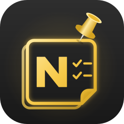
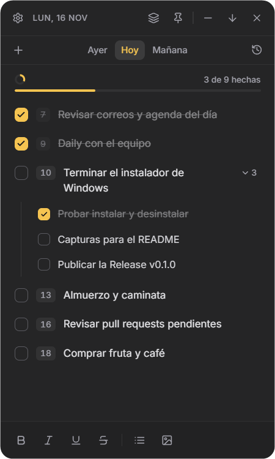
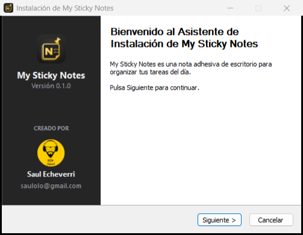
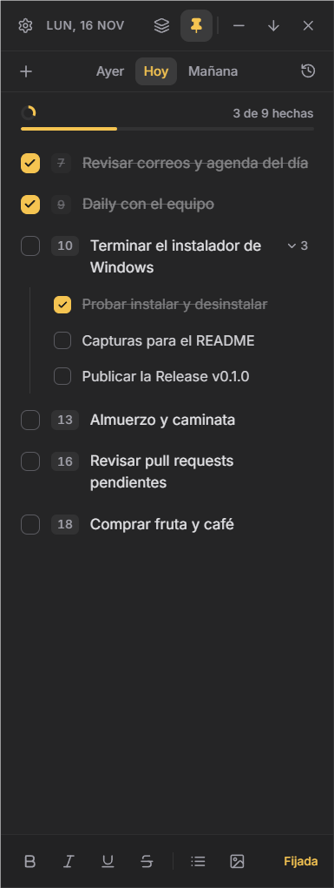
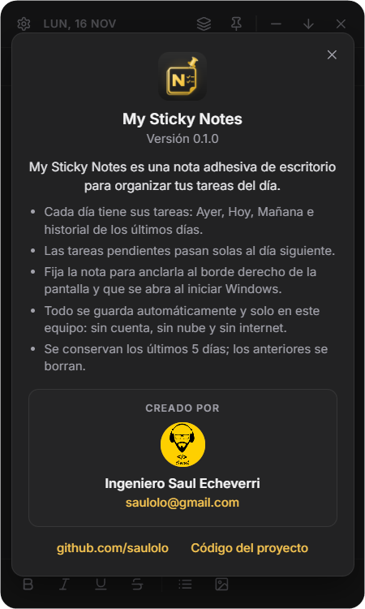
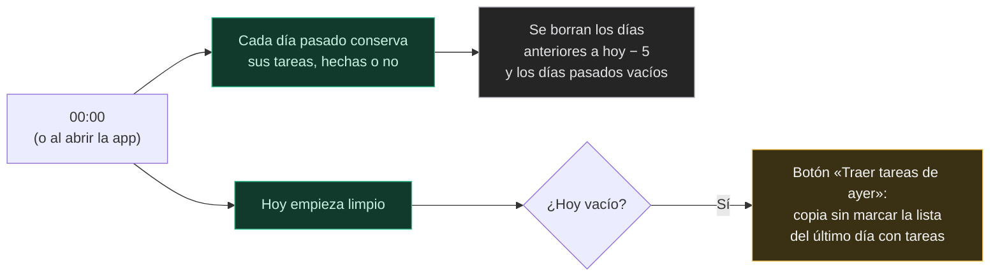

<div align="center">



# My Sticky Notes

### Tus tareas del día, siempre a la vista en el escritorio

Una nota adhesiva para Windows con una lista de tareas por día: **Ayer, Hoy y Mañana**.<br>
Cada día empieza limpio, con un clic traes las tareas de ayer y todo se guarda solo, en tu PC.

<sub>**My Sticky Notes · Organiza tu día sin salir del escritorio.**</sub>


<br>

[](https://github.com/saulolo/my-sticky-notes-frontend/releases/latest)

<br>



<sub>Capturas con datos de ejemplo.</sub>

</div>

---

## 📚 Contenido

- [✨ Qué hace en 30 segundos](#-qué-hace-en-30-segundos)
- [📋 Requisitos](#-requisitos)
- [🚀 Instalación](#-instalación)
- [🧭 Recorrido por la nota](#-recorrido-por-la-nota)
- [📅 Cómo cambian los días](#-cómo-cambian-los-días)
- [⌨️ Gestos y atajos](#️-gestos-y-atajos)
- [💾 Tus datos](#-tus-datos)
- [🗑️ Desinstalar](#️-desinstalar)
- [❓ Preguntas frecuentes](#-preguntas-frecuentes)
- [🛠️ Para desarrolladores](#️-para-desarrolladores)
- [✒️ Autor](#️-autor)
- [🎁 Propósito y agradecimientos](#-propósito-y-agradecimientos)
- [📜 Créditos y contacto](#-créditos-y-contacto)

---

## ✨ Qué hace en 30 segundos

| | |
|---|---|
| **Una lista por día** | Pestañas **Ayer**, **Hoy** y **Mañana**, más un historial con los 5 días anteriores. Todos se pueden editar. |
| **Hoy empieza limpio** | Nada se mueve solo: cada día conserva sus tareas, hechas o no. Si Hoy está vacío, el botón **Traer tareas de ayer** copia (sin marcar) la lista del último día con tareas. Se usa una vez al día. |
| **Orden manual** | Cada tarea lleva su hora (0–23) como etiqueta y tú decides el orden arrastrándolas. Una capa de subtareas, contraíble, que también reordenas o pasas a otra tarea. |
| **Progreso de un vistazo** | Anillo, `N de M hechas` y barra, contando tareas y subtareas. Un botón **marca o desmarca todas** las del día y otro las **borra todas** (con confirmación). |
| **Plantillas** | Una pestaña con grupos de tareas con nombre (por ejemplo, uno por empresa), apilados y plegables. Con **Copiar a Hoy** añades todas las tareas de un grupo al final de Hoy, sin marcar. Las plantillas nunca cambian solas. |
| **Aviso por hora** | Un interruptor (campana) en el bloque de progreso: a cada hora en punto, si hoy tienes una tarea pendiente con esa hora, suena tu mp3 y aparece una notificación de Windows. Empieza apagado. |
| **Fijar = anclar** | La nota se pega al borde derecho de la pantalla, a todo el alto, y se abre sola al iniciar Windows. |
| **Siempre encima** | Si quieres, la nota queda delante de las demás ventanas, libre o anclada. |
| **A tu medida** | Alto y ancho ajustables arrastrando los bordes (la nota libre); colapsar a solo la cabecera o minimizar a la barra de tareas. |
| **Se guarda sola** | Sin botón de guardar, sin cuenta y sin nube: un archivo en tu PC. |

---

## 📋 Requisitos

| Requisito | Detalle |
|---|---|
| **Sistema** | Windows 10 u 11 de 64 bits (x64). En Windows 11 ARM funciona por emulación x64 (sin probar). El instalador no arranca en Windows anterior a 10. |
| **Descarga** | ~120 MB (el instalador) |
| **Disco** | ~400 MB (la app instalada) |
| **Memoria** | ~100 MB con la app abierta |
| **Permisos** | Ninguno para "Solo para mí"; administrador para "Para todos los usuarios" |
| **Internet** | No hace falta (solo para descargar el instalador) |
| **Pantalla** | Alto útil mínimo de 300 px para la nota. Con varios monitores, la nota fijada se ancla al de más a la derecha |

---

## 🚀 Instalación

<p align="center"></p>

**1. Descarga** → `My Sticky Notes Setup <versión>.exe` desde [Releases](https://github.com/saulolo/my-sticky-notes-frontend/releases).

**2. Ábrelo** → el instalador no está firmado, así que Windows puede mostrar **"Windows protegió su PC"** (SmartScreen).

> [!IMPORTANT]
> En el aviso de SmartScreen pulsa **Más información** → **Ejecutar de todas formas**. Pasa con cualquier programa sin firma digital; la firma de código queda para una versión futura.

**3. Sigue el asistente** → Bienvenida, Licencia (MIT), tipo de instalación, carpeta y listo:

| Opción | Dónde instala | ¿Pide admin? |
|---|---|:---:|
| **Solo para mí** *(por defecto)* | `%LOCALAPPDATA%\Programs\My Sticky Notes` | No |
| **Para todos los usuarios** | `Program Files\My Sticky Notes` | Sí |

Crea accesos directos en el **escritorio** y en el **menú Inicio**, y al terminar puede abrir la app.

**4. Para actualizar** → instala la versión nueva encima. Tus notas se conservan.

> [!TIP]
> Si abres la app cuando ya está abierta, no se crea otra ventana: se trae al frente la que ya tienes (y se restaura si estaba minimizada).

---

## 🧭 Recorrido por la nota

### 1. Cabecera

La cabecera tiene dos filas. Arrastra la fila de arriba para mover la nota.

| Fila | Izquierda | Centro | Derecha |
|---|---|---|---|
| **Arriba** | Configuración · fecha corta del día (`Lun, 16 nov`) | zona para arrastrar | Siempre encima · Fijar · Colapsar (︿/﹀) · Minimizar (—) · Cerrar |
| **Abajo** | **+** Nueva tarea (en Plantillas, Nuevo grupo) | **Ayer · Hoy · Mañana · Plantillas** | Días anteriores |

### 2. Tareas y subtareas

- **+** (Nueva tarea) muestra la fila "Añadir nueva tarea…" con la hora (vacía = la hora actual). **Enter** crea la tarea y deja el foco listo para la siguiente. Si haces **clic fuera** con texto escrito, la tarea también se crea (con la hora vacía o mal escrita usa la hora actual); **Esc** descarta lo escrito.
- Cada tarea tiene casilla, hora, texto y botones para **añadir subtarea** y **eliminar**.
- **Doble clic** en el texto o la hora para editarlos. Cambiar la hora no mueve la tarea.
- **Arrastra** una tarea (clic sostenido en la fila, fuera de la casilla y los botones) para ponerla donde quieras. Las nuevas se añaden al final. Funciona en Ayer, Hoy, Mañana y el historial.
- Una sola capa de **subtareas**, con borde a la izquierda. Un contador `hechas/total` (por ejemplo `1/3`; en color de acento cuando están todas hechas) y un botón con chevron al pasar el mouse las contraen o expanden. También un **clic** en la fila de la tarea (el doble clic sigue editando).
- **Arrastra** una subtarea (clic sostenido en su fila, fuera de la casilla y la papelera) para reordenarla entre sus hermanas, o suéltala sobre **otra tarea del mismo día** para pasársela (queda como su última subtarea si no tenía o estaba contraída, y conserva su estado). **Esc** cancela.
- Marcar una tarea **no** marca sus subtareas.
- Las hechas se ven tachadas y atenuadas.

### 3. Progreso

Un anillo pequeño, el texto `N de M hechas` y una barra, todos con el mismo porcentaje. Cuentan tareas **y** subtareas del día activo.

Junto al texto, el botón de doble check **marca todas** las tareas y subtareas del día; con todo hecho pasa a **desmarcar todas**. A su lado, la papelera **Borrar todas** elimina todas las tareas del día (hechas o no, con sus subtareas) tras confirmar dentro de la nota: "¿Borrar las 5 tareas de Hoy?". Funciona en cualquier día; los demás días y las plantillas no cambian. Los dos botones se ocultan si el día no tiene tareas.

#### Aviso por hora

A la derecha del renglón hay una campana con un **interruptor**. Siempre está visible con la nota expandida, en todas las pestañas, y empieza **apagado**; su estado se recuerda.

- **Cuándo avisa:** a cada hora en punto (`14:00`, `15:00`…), si **hoy** hay al menos una tarea **sin hacer** con esa hora. Varias tareas a la misma hora dan un solo aviso. Las subtareas no cuentan, y da igual qué pestaña tengas abierta.
- **Qué hace:** suena tu mp3 una vez y aparece una notificación de Windows **silenciosa** (solo suena tu sonido) con el título `Es hora: 14:00` y los textos de esas tareas (hasta 3 y `…y N más`). Al hacer **clic** en ella, la nota se trae al frente (aunque estuviera minimizada), se expande y muestra **Hoy**.
- **Al encenderlo** suena el mp3 una vez, para comprobar que funciona. Al apagarlo no suena nada.
- **Siempre activo:** funciona con la nota libre, anclada, colapsada o minimizada a la barra de tareas.
- **Avisos perdidos:** no se recuperan. Si el PC estaba suspendido a las 14:00 y despierta a las 15:02, no avisa de las 14. Al abrir la app tampoco avisa de horas ya pasadas.

> [!NOTE]
> El sonido es un archivo propio: `src/renderer/assets/sounds/task-alert.mp3` (para cambiarlo, reemplázalo y vuelve a compilar). Sin ese archivo la app funciona igual, pero solo aparece la notificación. Si Windows tiene activado el **Asistente de concentración** o las notificaciones desactivadas, la notificación puede no verse; el sonido suena igual.

### 4. Plantillas

La pestaña **Plantillas** (después de Mañana; solo con icono en la nota anclada o estrecha) guarda listas que repites, por ejemplo una por empresa o por tipo de día.

- **Grupos apilados:** todos se ven a la vez, uno debajo del otro. Cada cabecera muestra el nombre, el número de tareas y el botón **Copiar a Hoy** (icono de copiar). Un **clic** en la cabecera pliega o despliega el grupo, y se recuerda.
- **Crear un grupo:** con el **+** de la fila de días (en Plantillas se llama "Nuevo grupo") o con **Crear grupo** si aún no hay ninguno. Escribe el nombre (hasta 40 caracteres) y pulsa **Enter**.
- **Al pasar el ratón** por la cabecera aparecen **+** (añadir tarea al grupo), lápiz (**renombrar**) y papelera (**borrar**, con confirmación dentro de la nota).
- **Ordenar grupos:** mantén presionada la cabecera y arrástrala (**Esc** cancela).
- **Tareas del grupo:** las mismas filas que en un día, **sin casilla** (las plantillas no se marcan): hora, texto, subtareas, editar, borrar y arrastrar para ordenar, siempre dentro de su grupo.
- **Copiar a Hoy:** añade todas las tareas del grupo, en su orden y con sus subtareas, al **final de Hoy**, sin marcar y con la misma hora y texto, y cambia a la pestaña Hoy. Puedes copiar el mismo grupo (u otro) las veces que quieras. Está desactivado si el grupo no tiene tareas.
- **Nada pasa solo:** las plantillas no se mueven a ningún día, no cuentan en el progreso ni dan aviso por hora. Marcar, editar o borrar una copia en Hoy no cambia la plantilla.

### 5. Fijar, colapsar y minimizar

<table>
<tr>
<td align="center" width="50%"><br><sub><b>Anclada</b>: borde derecho, todo el alto, esquinas rectas</sub></td>
<td align="center" width="50%"><br><sub><b>Colapsada</b>: solo la fila de arriba</sub></td>
</tr>
</table>

| Botón | Qué hace |
|---|---|
| **Fijar** | Ancla la nota al borde derecho del monitor no principal más a la derecha (con un solo monitor, el principal), a todo el alto sin tapar la barra de tareas. Anclada no se mueve ni cambia de alto, y en el pie dice **Fijada**. Además, **la app se abre sola al iniciar sesión**. Desfijar la devuelve a su posición y alto libres. |
| **Siempre encima** | La ventana queda delante de las demás, libre o anclada. Es independiente de Fijar. |
| **Colapsar** | Deja solo la fila de arriba de la cabecera (chevron arriba). Con la nota colapsada el botón dice **Expandir** y muestra el chevron abajo. |
| **Minimizar** (—) | Minimizado nativo de Windows; vuelve con el icono de la barra de tareas o Alt+Tab, tal como estaba. |

La nota libre mide **360 px** por defecto y puedes cambiar su **ancho** (mínimo 308 px) y su **alto** arrastrando los bordes; anclada mide **308 px** fijos. Se recuerdan posición, alto, ancho, fijada, colapsada, "Siempre encima" y el aviso por hora; si la posición queda fuera de pantalla, se centra.

### 6. Acerca de

<p align="center"></p>

En **Configuración → Acerca de My Sticky Notes** ves la versión, qué hace la app y los créditos, con enlaces al correo, a GitHub y al código del proyecto. Se cierra con **Esc**, con un clic fuera o con **×**.

---

## 📅 Cómo cambian los días



El botón **Traer tareas de ayer** aparece dentro de la lista vacía de Hoy, solo en esa pestaña, y se usa una vez al día (si borras todo después, no vuelve hasta el día siguiente). Las copias conservan hora, texto y orden, quedan desmarcadas y Ayer no cambia.

Al abrir, la pestaña activa siempre es **Hoy**. Con la app abierta a medianoche, la pestaña salta sola al nuevo día (si estabas en **Plantillas**, te quedas ahí). Las plantillas no cambian con el día.

---

## ⌨️ Gestos y atajos

| Acción | Cómo |
|---|---|
| Crear tarea | **+** (Nueva tarea) y luego **Enter** (el foco queda listo para la siguiente) |
| Crear la tarea a medio escribir | Clic fuera de la fila (con texto) |
| Descartar la tarea a medio escribir | **Esc** |
| Borrar todas las tareas del día | Papelera junto a "Marcar todas" y luego **Borrar** (**Esc** cancela) |
| Plegar o desplegar un grupo de plantillas | **Clic** en su cabecera |
| Reordenar grupos de plantillas | **Mantén presionada** la cabecera del grupo y arrástrala (**Esc** cancela) |
| Editar texto u hora | **Doble clic** |
| Reordenar tareas | **Mantén presionada** la fila de la tarea y arrástrala arriba o abajo (**Esc** cancela). Sus subtareas viajan con ella |
| Reordenar subtareas | **Mantén presionada** la fila de la subtarea y arrástrala arriba o abajo; si la sueltas sobre otra tarea del mismo día, pasa a esa tarea (**Esc** cancela) |
| Cambiar el alto | Arrastra el **borde superior o inferior** de la nota (mín. 300 px, máx. el alto útil del monitor) |
| Mover la nota | Arrastra la **fila de arriba** de la cabecera (libre, no anclada) |
| Volver de la barra de tareas | Clic en el icono o **Alt+Tab** |
| Cerrar "Acerca de" | **Esc**, clic fuera o **×** |

---

## 💾 Tus datos

> [!NOTE]
> Todo es local: un solo archivo con tus tareas y las preferencias de ventana. **Sin cuenta, sin nube y sin conexión.**

| | |
|---|---|
| **Dónde** | `%APPDATA%\my-sticky-notes\note.json` |
| **Cuándo se guarda** | Solo, unos 300 ms después de cada cambio y al cerrar la app |
| **Escritura segura** | Primero un archivo temporal y luego se renombra. Si el archivo se daña, se respalda como `note.corrupt-<fecha>.json` y la app arranca vacía |
| **Orden** | Se guarda el orden en que dejas las tareas de cada día. Al actualizar desde una versión anterior, las notas existentes se ordenan por hora una sola vez y desde ahí mandas tú |
| **Historial** | Se conservan hoy y los 5 días anteriores, con sus tareas hechas y pendientes tal como quedaron; los días más antiguos se borran |
| **Plantillas** | Se guardan en el mismo archivo, con su orden y si están plegadas. No caducan: el cambio de día no las toca |
| **Copia de seguridad** | Copia `note.json` con la app cerrada. Para restaurar, vuelve a ponerlo en su sitio |
| **Al desinstalar** | Las notas se conservan salvo que marques "Borrar también mis notas"; si reinstalas, las recuperas |
| **Versión de desarrollo** | `npm run dev` y `npm start` usan otra carpeta: `%APPDATA%\my-sticky-notes-dev\` |

---

## 🗑️ Desinstalar

**Configuración → Aplicaciones → My Sticky Notes → Desinstalar** (o "Agregar o quitar programas").

- Quita la app, los accesos directos y el inicio automático con Windows.
- Muestra la casilla **"Borrar también mis notas"**, desmarcada por defecto. Si la dejas así, tus notas se quedan en `%APPDATA%\my-sticky-notes\`.
- Al actualizar (instalar una versión nueva encima) las notas nunca se borran.

---

## ❓ Preguntas frecuentes

<details>
<summary><b>Windows dice "Windows protegió su PC". ¿Es seguro?</b></summary>
<br>
El aviso aparece porque el instalador no tiene firma digital, no porque tenga algo malo. Pulsa <b>Más información</b> → <b>Ejecutar de todas formas</b>. El código completo está en este repositorio.
</details>

<details>
<summary><b>¿Cómo hago que se abra al iniciar Windows?</b></summary>
<br>
Fija la nota. Fijada, la app se abre sola, y anclada, al iniciar sesión. Desfijada, no se abre sola.
</details>

<details>
<summary><b>Fijé la nota pero otras ventanas la tapan.</b></summary>
<br>
Fijar solo la ancla al borde. Para que quede delante de todo, activa también <b>Siempre encima</b>.
</details>

<details>
<summary><b>¿Puedo pasar mis notas a otro PC?</b></summary>
<br>
Sí: con la app cerrada en los dos equipos, copia <code>%APPDATA%\my-sticky-notes\note.json</code> del viejo al mismo sitio del nuevo.
</details>

<details>
<summary><b>El aviso por hora no suena o no aparece la notificación.</b></summary>
<br>
Comprueba que el interruptor de la campana esté encendido, que haya una tarea <b>sin hacer</b> de <b>hoy</b> con esa hora exacta, y que exista <code>src/renderer/assets/sounds/task-alert.mp3</code> (sin él, no suena). Si no ves la notificación, revisa que el Asistente de concentración de Windows no la esté ocultando.
</details>

<details>
<summary><b>¿Qué pasa con una tarea que no terminé ayer?</b></summary>
<br>
Se queda en Ayer tal como terminó el día. Si Hoy está vacío, pulsa <b>Traer tareas de ayer</b> para copiar la lista (sin marcar) a Hoy; también puedes verla en la pestaña Ayer o en el historial.
</details>

<details>
<summary><b>La nota no me deja cambiar el alto.</b></summary>
<br>
Anclada o colapsada el alto es fijo. Desfíjala o expándela y arrastra el borde superior o inferior.
</details>

<details>
<summary><b>Los botones de formato del pie no hacen nada.</b></summary>
<br>
Todavía no tienen función: llegarán en una versión futura.
</details>

---

## 🛠️ Para desarrolladores

<details>
<summary><b>Comandos, arquitectura, publicación y forma de trabajo</b></summary>

<br>

**Requisitos de desarrollo:** Node 24+ y npm 11+.

### Comandos

| Comando | Acción |
|---|---|
| `npm install` | Instala dependencias y Electron |
| `npm run dev` | Arranca la app con recarga en caliente (datos en `my-sticky-notes-dev`) |
| `npm run build` | Typecheck + build a `out/` |
| `npm start` | Ejecuta el build (`electron-vite preview`) |
| `npm test` | Tests (Vitest) |
| `npm run lint` | ESLint |
| `npm run typecheck` | `tsc` para node y web |
| `npm run format` | Prettier |
| `npm run dist` | Build + instalador NSIS en `dist/` |
| `npm run art` | Regenera `build/author-logo.ico` y `build/installer-header.bmp` |

### Arquitectura

Capas con dependencia en un solo sentido: `core` no conoce Electron ni el DOM.

```
src/
  core/        dominio + aplicación puros (sin electron ni DOM)
    domain/      Note (días), Task, operaciones inmutables, rotación de día, orden manual (`moveTask`, `moveSubtask`, `moveSubtaskToTask`), aviso por hora (`hour-alert`), validación y migración, días y etiquetas de fecha
    application/ NoteStore (estado, autoguardado, rotación), puertos (Clock, NoteRepository)
  main/        proceso principal: ventana (alto, anclaje), carpeta de datos, instancia única,
               inicio automático, enlaces externos permitidos, IPC, JsonNoteRepository
  preload/     puente seguro: expone window.stickyApi
  renderer/    UI en TypeScript vanilla (ui/, styles/, infrastructure/)
tests/         domain, application, main (lógica de ventana, carpetas y autoarranque sin Electron)
specs/         especificaciones (01 nota de escritorio … 08 orden manual de tareas … 10 orden manual de subtareas … 11 aviso sonoro por hora)
build/         recursos del instalador: icono, logo del autor, cabecera, installer.nsh
scripts/       make-installer-art.mjs (npm run art)
docs/          mockup de referencia (references/) e imágenes del README (img/)
```

**Seguridad:** `contextIsolation: true`, `nodeIntegration: false`, `sandbox: true`. El renderer solo ve `window.stickyApi`; para abrir enlaces envía una clave y el proceso principal valida contra una lista cerrada.

### Stack

Electron 44, electron-vite 6, Vite 8, TypeScript 5.9, Vitest 3, ESLint 10, Prettier, electron-builder 26 (NSIS). Fuente Inter local (`@fontsource/inter`).

### Publicar una versión

1. Sube la versión en `package.json` (`version`).
2. `npm run dist` → `dist/My Sticky Notes Setup <versión>.exe`. Cierra antes cualquier instalador abierto (bloquea el `.exe`).
3. Prueba el instalador: instalar encima de la versión anterior, abrir y comprobar que las notas siguen.
4. Commit, tag y push: `git tag v<versión>` y `git push origin v<versión>`.
5. En GitHub → **Releases** → **Draft a new release**: elige el tag, escribe los cambios, adjunta el `.exe` y publica.

### Cómo se desarrolla (SDD)

- El proyecto sigue Spec Driven Design: cada cambio nace de una spec en `specs/`.
- Cada spec se trabaja en su propia rama `spec-NN-slug` y se implementa paso a paso.
- Los cambios de alcance durante la implementación se anotan en la spec ("añadido durante la implementación").
- Después de cada spec se actualizan `CLAUDE.md` y este README.

</details>

---

## ✒️ Autor

¡Hola! Soy **Saul Echeverri Duque**, creador y desarrollador de este proyecto. Te comparto un poco sobre mi formación y experiencia.

### Formación académica

- Tecnólogo en **Análisis y Desarrollo de Software** · SENA.
- **Ingeniero de Software** · Universidad de Antioquia, Colombia.
- Más de **6 años** de experiencia en desarrollo de software, con microservicios en **Java, Spring Boot y Angular**.

### Trayectoria profesional

Desarrollador de software con sólida experiencia en el ecosistema Java y en soluciones enfocadas en productividad, escalabilidad y buenas prácticas de ingeniería. He aportado valor técnico en empresas del sector tecnológico y financiero:

| Empresa | Rol |
|---|---|
| [IAS Software](https://www.ias.com.co/) | Desarrollador de Software Full Stack |
| [Cidenet](https://cidenet.net/) | Analista de Desarrollo |
| Convertic | Analista de Desarrollo |

### Pasión por la programación

- Mi viaje en la programación comenzó en **2020** y desde entonces he estado inmerso en el universo del desarrollo de software.
- Mi principal área de enfoque es **Java y Angular**, pero este proyecto demuestra que las buenas prácticas (arquitectura por capas, dominio puro y testeable, separación entre lógica y presentación) aplican en cualquier tecnología: aquí, en una app de escritorio con **Electron y TypeScript sin frameworks de UI**.

---

## 🎁 Propósito y agradecimientos

My Sticky Notes nace de una necesidad simple: tener las tareas del día **siempre a la vista**, sin abrir una app pesada, sin cuentas y sin depender de internet.

Quería una nota que se sintiera nativa en el escritorio, que no dejara tareas olvidadas en días pasados y que se pudiera compartir con cualquier persona como un programa profesional, con su instalador.

Este proyecto es también un espacio continuo de aprendizaje y aplicación práctica de la ingeniería de software: specs, capas bien separadas, pruebas y empaquetado, demostrando que una herramienta pequeña y bien diseñada tiene un impacto real en el día a día.

Gracias a quienes la prueban, la usan y comparten sus ideas para mejorarla.

---

## 📜 Créditos y contacto

Este proyecto fue desarrollado por **[Saul Echeverri](https://github.com/saulolo)** para organizar mis tareas diarias, pero es útil para cualquier persona que quiera una lista de tareas simple y siempre visible en Windows.

Agradezco sinceramente el tiempo dedicado a revisar este proyecto. Valoro cualquier feedback técnico sobre las decisiones de arquitectura, diseño y buenas prácticas aplicadas, y quedo a disposición para profundizar en cualquier detalle de la implementación.

<div align="center">

[](https://github.com/saulolo)
[](mailto:saulolo@gmail.com)
[](https://www.linkedin.com/in/saul-echeverri-duque/)

</div>

---

### Metadatos del documento

| Campo | Detalles |
|:---|:---|
| **Título** | My Sticky Notes |
| **Autor** | Saul Echeverri |
| **Versión** | 0.1.0 |
| **Licencia** | MIT (ver [`LICENSE`](LICENSE)) |
| **Fecha de creación** | 12 de noviembre de 2026 |
| **Última actualización** | 16 de noviembre de 2026 |
| **Notas adicionales** | App de escritorio para Windows (Electron + TypeScript, sin framework de UI) con una lista de tareas por día, botón para traer las tareas de ayer, aviso sonoro por hora, anclaje al borde de la pantalla y guardado local. |

---

<div align="center">
<sub>Hecho para organizar el día · Colombia</sub>
</div>
